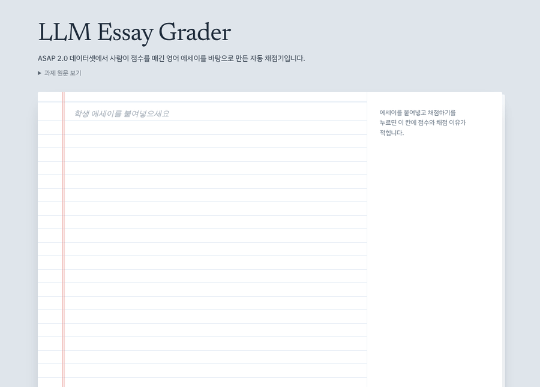
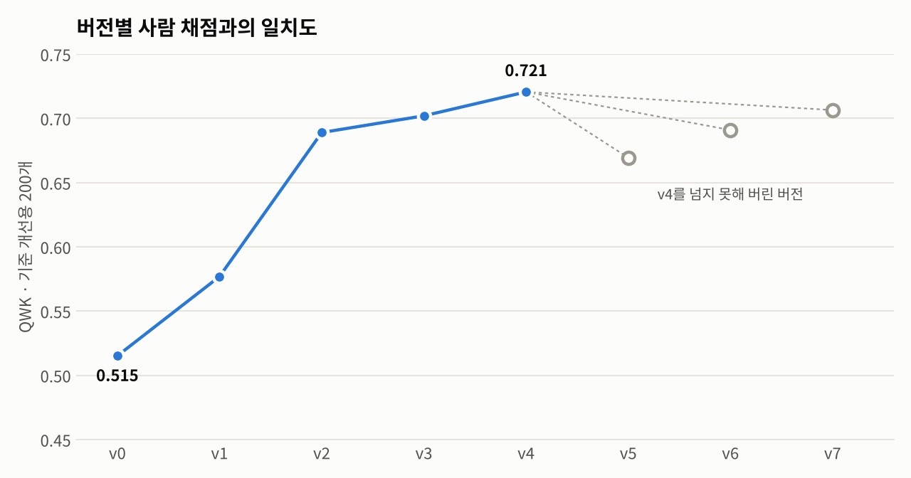

# 채점 규칙을 스스로 찾는 LLM




## 핵심 결과
LLM이 루브릭에 없는 채점 규칙을 스스로 찾아내 사람이 채점한 점수와의 일치도를 QWK 0.39에서 0.70으로 높였다.
- 최종 평가용 200개에서 공식 루브릭 그대로의 LLM 채점은 QWK 0.39, 자동 개선한 기준은 0.70
- 사람 점수와 1점 이내로 일치한 비율 96%
- 내용 없이 길이만 늘린 글에 표면특징 모델은 평균 1.9점을 더 줬고, 이 시스템은 오히려 감점

---

## 1. 문제의식

서술형·논술형 과제 채점에는 많은 시간이 걸린다. LLM에 루브릭을 주고 채점을 맡기면 빠르지만, 루브릭 문장과 실제 사람의 채점 감각 사이에는 차이가 있다. 

사람이 채점한 데이터 일부를 보여주고 LLM이 사람과 어긋난 부분을 찾아 채점 기준을 스스로 고쳐나가게 하면 사람 채점에 가까운 자동 채점기를 만들 수 있다고 보았다.

이를 확인하기 위해 세 가지 질문을 세우고 실험했다.

1. 기준을 자동으로 고치면 사람 채점에 얼마나 가까워지는가
2. 기준을 고칠 때 보지 않은 글에서도 성능이 유지되는가
3. 글 길이 같은 단순한 방법보다 나은 점이 있는가

## 2. 시스템 구조

```
            ┌──────────────────────────────────────────────────────┐
            ▼                                                      │
  채점 기준 vN → ① 채점 → ② 사람 점수와 비교 → ③ 기준 수정 → 채점 기준 vN+1
                   Haiku      일치도, 점수별 오차      Sonnet
                   개선용 200개  크게 틀린 사례 15개     수정 이력 참고, 최고 버전을 고침

  반복이 끝나면 최고 버전으로 최종 평가용 200개 채점
```

| 역할 | 모델 | 이유 |
|---|---|---|
| 채점 | Claude Haiku 5.5 | 호출이 많아 저렴한 모델, 고정된 부분은 캐싱 |
| 기준 수정 | Claude Sonnet 5.5 | 틀린 사례를 일반화하는 작업이라 상위 모델 |

- 가장 좋았던 버전에서만 다시 고친다. 수정이 실패하면 그 버전은 버리고, 다음 수정은 최고 버전에서 다시 시작한다.
- 수정 이력을 함께 전달한다. 버전별 점수와 변경 내용, 그 결과를 보여줘서 실패한 방향을 반복하지 않게 했다. 실제로 v6은 v5의 큰 수정이 실패한 것을 보고 오류가 큰 세 곳만 고쳤고, v7은 점수 범위를 좁히는 수정을 피했다.
- 기준에 글자 수 규칙을 쓰지 못하게 했다. 이 데이터는 글 길이와 점수의 상관이 높아서, 허용하면 길이로 점수를 맞추는 기준이 나올 수 있다. 구성과 근거와 설명으로 판단하는 기준이어야 길이 측정과 다른 가치를 가진다.

## 3. 실험 설정

데이터는 ASAP 2.0의 Car-free cities 주제 1,959개다. 미국 중고등학생이 자동차 사용을 줄이는 것의 장점에 대해 지문 4개를 읽고 쓴 설명문이며, 사람 점수는 1~6점이다.

| 묶음 | 개수 | 용도 |
|---|---|---|
| 기준 개선용 | 200 | 채점, 비교, 기준 수정 |
| 최종 평가용 | 200 | 마지막에 한 번만 사용 |
| 나머지 | 1,559 | 강건성 테스트 |

#### 비교 대상

- 공식 루브릭: PERSUADE 2.0의 자료 기반 Holistic Rating Form 원문
- 표면특징 모델: 단어 수, 어휘 다양성, 문장 수, 문단 수, 지문과 겹치는 표현 비율 등 7개 특징으로 만든 회귀 모델. 전통적인 자동 채점 방식을 참고해 직접 구성했고, 같은 개선용 200개로 학습했다.
- 길이 기준선: 단어 수 순서대로 점수를 매긴다.

#### 평가 지표

- QWK: AI 점수가 사람 점수와 얼마나 비슷한지를 0~1로 나타낸 값. 1에 가까울수록 사람과 같게 채점한 것이고, 점수 차이가 클수록 더 많이 깎인다.
- 정확 일치: 사람과 같은 점수를 준 비율
- 1점 이내: 사람 점수와 1점 이하로 차이 난 비율

## 4. 결과

### Q1. 기준을 자동으로 고치면 사람 채점에 얼마나 가까워지는가

<picture>
  <source media="(prefers-color-scheme: dark)" srcset="docs/improvement_curve_dark.png">
  
</picture>

| 버전 | 수정 출발점 | QWK | 정확 일치 | 1점 이내 |
|---|---|---|---|---|
| v0 공식 루브릭 | – | 0.515 | 46% | 94% |
| v1 | v0 | 0.577 | 50% | 96% |
| v2 | v1 | 0.689 | 56% | 97% |
| v3 | v2 | 0.702 | 57% | 97% |
| v4 | v3 | 0.721 | 55% | 97% |
| v5 | v4 | 0.669 | 52% | 96% |
| v6 | v4 | 0.691 | 55% | 96% |
| v7 | v4 | 0.706 | 53% | 96% |

v4 이후 세 번 연속 개선이 없어 반복을 멈췄다.

#### LLM이 찾아낸 규칙
- 지문 문장을 거의 그대로 옮기거나, 지문 순서대로 사실만 나열하고 한 줄 소감을 붙인 글은 출처를 많이 써도 1~2점
- 문단이 장점별로 묶여 있고 각 장점을 자기 말로 설명하면 3점 이상
- 서론에서 장점을 예고하고, 여러 지문의 구체적 근거를 장점과 연결하고, 결론이 있으면 5점
- 철자와 문법 오류는 의미 전달을 방해할 때만 감점하고, 구성과 전개가 좋으면 오류가 많아도 높은 점수
- 3점에 몰지 말고 1~6점 전체를 사용

### Q2. 기준을 고칠 때 보지 않은 글에서도 유지되는가

루프에서 한 번도 보지 않은 최종 평가용 200개 결과다.

| 방법 | QWK | 95% 구간 | 정확 일치 | 1점 이내 | 2점 이상 차이 |
|---|---|---|---|---|---|
| 공식 루브릭 | 0.392 | 0.28~0.49 | 38% | 92% | 8% |
| 자동 개선 | 0.697 | 0.62~0.76 | 52% | 96% | 4% |
| 표면특징 모델 | 0.656 | 0.56~0.73 | 46% | 93% | 7% |
| 길이 기준선 | 0.634 | – | 44% | 94% | 6% |

공식 루브릭 대비 0.305 올랐고 95% 구간은 0.21~0.40이다. 개선 효과가 처음 보는 글에서도 유지됐다.

| 점수별 정확 일치 | 1점 | 2점 | 3점 | 4점 | 5점 |
|---|---|---|---|---|---|
| 글 수 | 14 | 42 | 72 | 55 | 16 |
| 공식 루브릭 | 21% | 29% | 76% | 13% | 0% |
| 자동 개선 | 43% | 52% | 51% | 64% | 25% |

점수를 1~6점 전체로 넓게 쓰게 되면서 양 끝과 4점은 크게 좋아졌고, 3점 글 일부를 2점이나 4점으로 보내 3점 정확도는 내려갔다.

### Q3. 단순한 방법보다 나은 점이 있는가

정확도는 자동 개선이 표면특징 모델보다 0.04 높지만, 95% 구간이 -0.06~0.14라 확실한 차이는 아니다. 이 데이터에서는 잘 쓴 글이 대체로 길어서 단순한 방법도 꽤 잘 맞힌다.

그렇다면 내용 없이 길이만 늘린 글은 어떻게 채점할까. 사람 점수 1~2점인 글 30개를 두 방식으로 약 두 배로 늘려 채점했다. 기준 개선과 모델 학습에 쓰지 않은 글이다.

| 버전 | 단어 수 | 표면특징 평균 | 자동 개선 평균 | 4점 이상 글 수 |
|---|---|---|---|---|
| 원본 | 310 | 2.33 | 2.17 | – |
| 지문 이어 붙이기 | 632 | 3.03 | 1.43 | 8 대 0 |
| 자기 문장 반복 | 620 | 4.20 | 1.43 | 24 대 0 |

4점 이상 글 수는 표면특징 모델 대 자동 개선 순서다. 표면특징 모델은 문장을 섞어 반복하기만 해도 30개 모두 점수를 올렸고, 사람이 1~2점을 준 글 24개에 4점 이상을 줬다. 자동 개선 기준은 오히려 감점했고, 채점 이유에 마지막 문단들이 앞 문장을 섞어 반복한 것이라고 적었다.

## 5. 한계

- 표면특징 모델 대비 정확도 우세는 통계적으로 확실하지 않다.
- Car-free cities 한 주제에서만 검증했다.
- 길이 테스트는 30개 규모이고 두 가지 방식만 썼다. 그럴듯한 문장으로 교묘하게 늘린 글에도 강한지는 확인하지 않았다.

## 6. 실행 방법

```bash
pip install -r requirements.txt
echo "ANTHROPIC_API_KEY=..." > .env
# Kaggle에서 ASAP 2.0 데이터를 받아 data/asap/ASAP2_train_sourcetexts.csv 로 저장

python src/split.py                             # 데이터 나누기
python src/topic_pilot.py                       # 주제 후보 예비 채점
python src/loop.py --estimate                   # 예상 비용 확인
python src/loop.py --upto 7                     # 기준 개선 루프 v0~v7
python src/reselect.py                          # 최종 버전 선정
python src/evaluate.py                          # 최종 평가
python src/padding_test.py --out runs/padding   # 길이 테스트
python src/make_figures.py                      # 그림
python src/server.py                            # 시연 화면, http://localhost:8600
```

모든 스크립트는 --estimate로 예상 비용을 먼저 볼 수 있고, 중간에 멈춰도 이미 채점한 부분은 건너뛰고 이어서 실행된다.

```
├─ src/
│  ├─ llm.py            API 호출, 비용 기록, 예산 상한 자동 정지
│  ├─ asap.py           데이터 읽기, 채점 프롬프트 조립, 표면특징
│  ├─ split.py          데이터 나누기
│  ├─ loop.py           기준 개선 루프
│  ├─ stats.py          일치도 통계, 크게 틀린 사례 선택
│  ├─ evaluate.py       최종 평가
│  ├─ reselect.py       최종 버전 선정
│  ├─ padding_test.py   길이 테스트
│  ├─ topic_pilot.py    주제 후보 예비 채점
│  ├─ make_figures.py   그림
│  ├─ server.py         시연 화면 서버
│  └─ record_demo.py    시연 GIF 녹화
├─ prompts/
│  ├─ asap_grade_system.md      채점 프롬프트
│  ├─ asap_revise_system.md     기준 수정 지시
│  ├─ asap_revise_user.md       기준 수정 입력
│  ├─ rubric_official.md        공식 루브릭
│  ├─ criteria_final.md         최종 채점 기준
│  └─ criteria_final_NOTICE.md  최종 기준의 출처와 라이선스
├─ web/                 시연 화면
├─ runs/                버전별 기준, 변경 내용, 통계, 평가 결과, 비용 기록
└─ docs/                그림
```

## 7. 출처와 라이선스

- 데이터: ASAP 2.0, The Learning Agency, CC BY 4.0. 원본 데이터는 이 저장소에 포함하지 않는다. 시연 GIF의 에세이도 이 데이터에서 가져왔다.
- 공식 루브릭: Crossley et al., [PERSUADE 2.0 corpus](https://github.com/scrosseye/persuade_corpus_2.0), Holistic Rating Form, CC BY-NC-SA 4.0
- 최종 채점 기준: 위 루브릭의 2차 저작물로 CC BY-NC-SA 4.0
- 참고 연구
  - Harada et al., Reflect-and-Revise, arXiv 2510.09030
  - Liu et al., AutoCalibrate, LREC-COLING 2024
  - arXiv 2601.08654, arXiv 2509.10417
